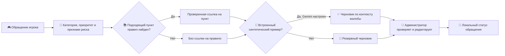

# Support Copilot · Grand Mobile

Python/FastAPI + HTML/CSS/JS: очередь обращений, triage, поиск правил, Gemini и ручная проверка черновиков. Репозиторий запускается самостоятельно в демонстрационном режиме. Закрытый набор кейса и персональный API-ключ не нужны для первого запуска.

## Как это работает

> Игрок пишет: «Мой персонаж застрял в гараже». Copilot помогает администратору быстро понять проблему, найти подтверждённые пункты правил и подготовить ответ именно об этой ситуации. Решение остаётся за человеком.



**Возможности проекта:**

- **Очередь обращений:** жалобы и репорты собраны в одном интерфейсе; видны категория, приоритет и причины разбора.
- **Проверка правил:** система показывает только найденные в подключённом источнике пункты. Если подтверждённого пункта нет, ссылка не появляется.
- **Gemini для демонстрации:** анализирует текст встроенного синтетического обращения, предлагает категорию, отмечает необходимость участия человека и пишет черновик ответа по ситуации. При недоступности модели используется резервный черновик.
- **Контроль администратора:** можно исправить ответ, передать сложный случай на рассмотрение и изменить статус обращения. Действие «Отправить» сохраняет статус локально.
- **Инструменты для разработчиков:** HTTP API, пакетная обработка JSONL, тесты и запуск через Docker.

В публичном архиве используется демонстрационная таксономия без официальных правил Grand Mobile. Чтобы появились ссылки на реальные пункты, их нужно подключить отдельно. Внешний вызов Gemini в этой сборке разрешён только для встроенных синтетических примеров.

## Запуск с Docker (Mac, Windows, Linux)

Установите Docker с Compose, откройте терминал в распакованной папке проекта и выполните:

```sh
docker compose up --build
```

Откройте http://localhost:8000 . Без ключа работают очередь, классификация, редактирование, эскалация и резервные ответы. Остановка: Ctrl+C, затем `docker compose down`. SQLite хранится в именованном Docker-томе и сохраняется при перезапуске. Порт доступен только на этом компьютере.

## Gemini

Скопируйте `.env.example` в `.env` (Mac/Linux: `cp .env.example .env`; Windows PowerShell: `Copy-Item .env.example .env`). Впишите свой ключ в `GEMINI_API_KEY=`. Получить ключ: https://aistudio.google.com/apikey . Пересоздайте контейнер:

```sh
docker compose up --build --force-recreate
```

В карточке «Синтетический пример» нажмите «Проанализировать заново с ИИ». Новые обычные обращения, POST /triage и исходный датасет не отправляются Google: разрешение в этой сборке распространяется только на встроенные искусственные примеры. Клиентское поле synthetic не может обойти это ограничение. При сбое Gemini или невалидном ответе показывается причина и резервный черновик. Gemini может тарифицироваться Google; ключ никогда не помещайте в GitHub или клиентский JavaScript.

## Запуск без Docker

Нужен Python 3.14. В терминале из папки проекта:

```sh
python3.14 -m venv .venv
.venv/bin/python -m pip install -r requirements.lock
.venv/bin/python -m uvicorn app.main:app --host 127.0.0.1 --port 8000
```

Windows PowerShell:

```powershell
py -3.14 -m venv .venv
.venv\Scripts\python.exe -m pip install -r requirements.lock
.venv\Scripts\python.exe -m uvicorn app.main:app --host 127.0.0.1 --port 8000
```

Mac/Linux также поддерживают `make dev`. Наличие старой локальной Ollama не требуется. При использовании переменных окружения они имеют приоритет над .env.

## Что включено

- `app/`: HTTP API, движок, Gemini-адаптер, SQLite и русскоязычный интерфейс.
- `demo_data/`: самостоятельно составленная демонстрационная таксономия; пустой список правил.
- `scripts/`: запуск, пакетный прогноз, оценка, сборка публичного ZIP.
- `tests/`: синтетические проверки, включая запрет внешней отправки обычных обращений.
- `Dockerfile`, `compose.yaml`: запуск в контейнере.
- `.github/workflows/checks.yml`: тесты и проверка сборки Docker в GitHub Actions.
- `docs/GITHUB.md`: инструкция для получателя архива.

Демонстрационная таксономия не является официальной таксономией Grand Mobile. Официальные пункты правил не распространяются в репозитории и не заменены выдуманными. Поэтому в деморежиме цитат нет. Для выполнения кейса в полном режиме используйте оригинальную таксономию и правила.

## Подключение официального кейса

Получите файлы у организаторов на условиях их использования. Для запуска без Docker поместите `taxonomy.json` и `rules.json` в игнорируемую папку `private_data/` и задайте в .env:

```ini
SUPPORT_DATA_DIR=private_data
```

Перезапустите сервер. Для Docker добавьте отдельное монтирование этой папки только на чтение в `/app/private_data` и измените `SUPPORT_DATA_DIR` в compose.yaml на этот путь. Не добавляйте закрытые данные в Dockerfile или репозиторий. Выданные tickets_train.jsonl.gz и tickets_valid.jsonl нужны только для полной оценки; приложение их автоматически не импортирует.

## API и пакетный прогноз

- GET /health — состояние; mode=demo или case.
- POST /triage — kind + messages; необязательные поля кейса поддерживаются.
- GET /api/tickets, POST /api/tickets — локальная очередь.
- PATCH /api/tickets/{id} — edit, send, escalate.
- POST /api/tickets/{id}/reanalyze — повторный анализ до сохранения правок.
- /docs — документация API.

```sh
curl http://localhost:8000/health
curl http://localhost:8000/triage -H 'Content-Type: application/json' -d '{"kind":"report","lang":"ru","messages":[{"role":"player","text":"Синтетический персонаж застрял в гараже."}]}'
make predict IN=tickets.jsonl OUT=pred.jsonl
```

Без Make используйте `python -m scripts.predict --input tickets.jsonl --output pred.jsonl` из активированной среды. CLI сохраняет ticket_id, читает построчно, принимает gzip, пишет атомарно. Ни admin-сообщения, ни verdict/punishment/violation не используются при прогнозе.

## Проверки и ограничения

```sh
make test
# Только искусственные примеры; с настроенным Gemini делает внешние API-запросы:
make evaluate-ai
# Требует официальные файлы train/valid в SUPPORT_DATA_DIR:
SUPPORT_AI=off make evaluate
```

Тесты не требуют ключа и не обращаются к Gemini; интеграционные ответы API в них имитируются. Реальные замеры Gemini создаются отдельно скриптом evaluate_ai. Нельзя переносить скорость локальных эвристик на облачную модель.

Эталонных category/priority в выданном наборе нет, поэтому accuracy и macro-F1 не заявляются. Для оценки качества нужна ручная разметка; confidence эвристический. Кириллица и казахские замены нормализуются. ru/kk/uz/en/es/pt поддерживаются, lat/und требуют уточнения языка. Качество ответов, особенно kk/uz, проверяет человек.

Цитаты сверяются по разделу, номеру и точному тексту источника. Вложения считаются только по метаданным. Платежи, безопасность аккаунта, наказания и сомнительные случаи передаются человеку. «Отправить» меняет только локальный статус. Приложение не связано с игровым API. Обратная связь хранится в локальной SQLite; дедупликация использует ограниченные отпечатки в памяти.

Это локальный MVP без системы входа администраторов. GitHub хранит код и запускает CI; GitHub Pages не исполняет этот Python-сервис. Для публичного сайта потребуется отдельное развёртывание, авторизация и настройка домена. Данный архив не выполняет публикацию сайта.

## Документация используемых платформ

[FastAPI/Docker](https://fastapi.tiangolo.com/deployment/docker/), [GitHub Actions/Python](https://docs.github.com/en/actions/tutorials/build-and-test-code/python), [Gemini JSON Schema](https://ai.google.dev/gemini-api/docs/generate-content/structured-output).
